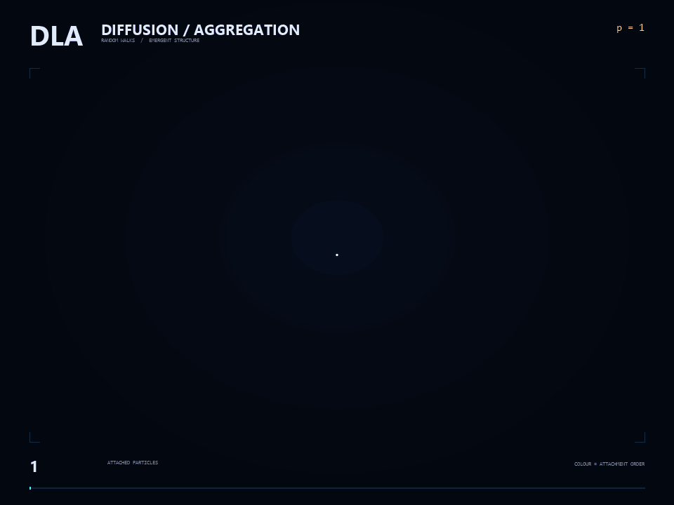
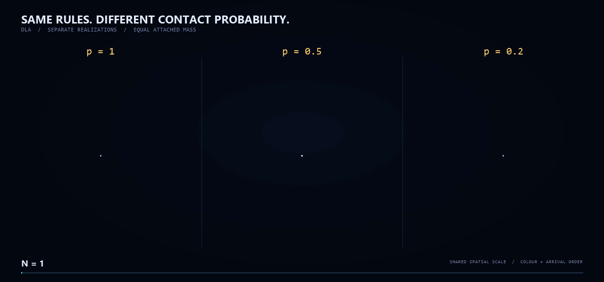
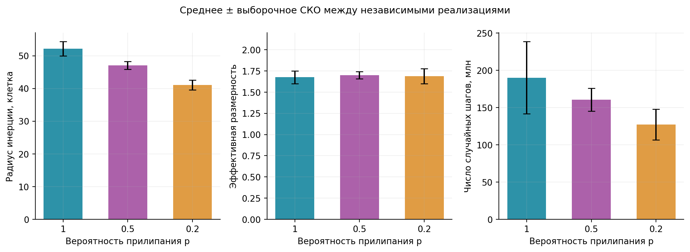

# DLA — порядок из случайности

**Лабораторная работа № 3 по компьютерному моделированию**

Рост фрактальных структур методом диффузионно-ограниченной агрегации.

`Python 3.13` · `NumPy` · `Numba` · `Pillow` · `Монте-Карло`



*12 000 частиц · p = 1 · seed = 42 · 140 кадров · 7 секунд.*

Каждая ветвь получена случайными блужданиями частиц. Цвет обозначает **порядок присоединения**: от бирюзового к синему, фиолетовому и золотому. Камера и цветовая шкала фиксированы на протяжении анимации. Свечение добавлено при отрисовке; координаты частиц сохраняются без изменений. Счётчик показывает число присоединившихся частиц вместе с зародышем.

[Запуск](#быстрый-запуск) · [Сравнение режимов](#вероятность-прилипания) · [Результаты](#численные-результаты) · [Документы](#документы) · [Воспроизведение](#воспроизведение-расчётов)

## Что делает проект

На квадратной решётке находится неподвижный зародыш. Новые частицы случайно перемещаются по четырём направлениям и закрепляются при контакте с растущим кластером. Из простого локального правила возникает ветвистая структура.

Программа позволяет:

- выращивать кластеры с заданными числом частиц, вероятностью прилипания и seed;
- сохранять всю историю присоединения в NPZ и повторять отрисовку без нового роста;
- проверять свободную диффузию по теоретическому закону среднеквадратичного смещения;
- измерять радиус инерции и эффективную фрактальную размерность;
- сравнивать несколько реализаций, параметры прилипания и численные границы;
- создавать PNG, GIF, таблицы результатов и отчёт DOCX.

Теоретическая основа — случайные блуждания и диффузия из лекции № 8, методы Монте-Карло и статистическая обработка из лекции № 9. DLA выбрана как приложение этих методов. Математическая постановка и ограничения изложены в [теории](docs/THEORY.md).

## Быстрый запуск

Откройте PowerShell в корне проекта, где находится `main.py`. Для проверенной среды используется Python 3.13.

```powershell
py -3.13 -m venv .venv
.\.venv\Scripts\python.exe -m pip install -r requirements-dev.txt
.\.venv\Scripts\python.exe main.py simulate --particles 3000 --p 1 --seed 42 --out results/demo --animate
```

Активация окружения не требуется: команды непосредственно вызывают его интерпретатор. `requirements-dev.txt` устанавливает библиотеки модели, генератор DOCX и pytest. Для запуска только модели достаточно `requirements.txt`.

После расчёта откройте `results/demo/growth.gif` или `results/demo/poster.png`. Первый запуск включает подготовку ядра Numba; создание GIF выполняется после моделирования и может занимать заметную часть общего времени. Видеокарта и FFmpeg не требуются.

| Файл в `results/demo` | Содержимое |
|---|---|
| `cluster.npz` | Координаты в порядке присоединения, параметры и статистика ядра |
| `positions.csv` | Те же целочисленные координаты в табличном виде |
| `metrics.json` | Геометрические характеристики и сведения о среде |
| `poster.png` | Итоговый кластер |
| `growth.png`, `dimension.png` | Научные графики геометрии |
| `growth.gif` | Анимация, если указан `--animate` |

Для короткой проверки установки можно заменить `--particles 3000` на `--particles 300`.

## Вероятность прилипания



*По 3000 частиц в каждом режиме · p = 1; 0,5; 0,2 · seed = 100 · общий пространственный масштаб.*

При p = 1 частица закрепляется при первом контакте. При меньшей вероятности она может продолжить движение вдоль доступной поверхности и проникнуть глубже между ветвями. После неудачного прилипания выполняется очередная попытка случайного шага. Переход в занятую клетку отклоняется; контакт проверяется снова на следующем такте.

Панели показывают отдельные реализации с одинаковым числом присоединившихся частиц. Один и тот же числовой seed использован для каждого режима, но различие правил меняет расход случайных чисел и дальнейшую историю роста. Анимация иллюстрирует морфологию; статистические выводы основаны на серии запусков.

## Численные результаты

Основная серия: **N = 3000**, по **6 реализаций** для каждого p, seed от **100 до 105**. Радиус инерции измерен относительно центра масс в единицах шага решётки.

| Вероятность p | Радиус инерции Rg | Эффективная размерность D_eff |
|---:|---:|---:|
| 1,0 | 52,14 ± 2,17 | 1,675 ± 0,075 |
| 0,5 | 47,09 ± 1,18 | 1,701 ± 0,043 |
| 0,2 | 41,06 ± 1,51 | 1,690 ± 0,089 |

Здесь указаны **среднее ± выборочное стандартное отклонение** между шестью seed. Это разброс отдельных реализаций, а не доверительный интервал среднего.

В данной серии уменьшение p от 1 до 0,2 сопровождается уменьшением среднего Rg примерно на 21 %: при одинаковом числе частиц кластеры становятся компактнее. Различия средних оценок размерности меньше межреализационного разброса. Эти данные не дают основания уверенно утверждать изменение предельной фрактальной размерности с p.



**Проверка свободного блуждания:** 20 000 траекторий по 400 единичных шагов дали среднее r² = **401,1008** при теоретическом значении **400**. Отклонение составляет 0,392 стандартной ошибки; заданная проверка пройдена.

Для оценки D_eff используется зависимость массы от радиуса на промежуточных масштабах конечного кластера. Проверка границ запуска и перезапуска выявляет различия средних геометрических характеристик порядка нескольких процентов. Поэтому D_eff трактуется как **эффективная оценка в выбранном диапазоне**, а независимость от численных границ не объявляется.

Полные данные: [summary.json](docs/results/summary.json) · [таблица запусков CSV](docs/results/runs.csv) · [проверка диффузии](docs/results/validation.png) · [рост радиуса](docs/results/growth.png) · [масса и радиус](docs/results/dimension.png) · [влияние границ](docs/results/boundary.png).

## Воспроизведение расчётов

Проверить свободную диффузию:

```powershell
.\.venv\Scripts\python.exe main.py validate --trials 20000 --steps 400 --seed 2026 --out results/validation
```

Повторить серию по вероятности прилипания и численным границам:

```powershell
.\.venv\Scripts\python.exe main.py experiments --particles 3000 --replicates 6 --seed 100 --out results/study
```

Перерисовать готовый кластер из 12 000 частиц, сохранив исходные координаты:

```powershell
.\.venv\Scripts\python.exe main.py render --input docs/data/showcase.npz --out results/from-archive --animate
```

После расчёта `experiments` обновить изображения README и опубликованный набор данных:

```powershell
.\.venv\Scripts\python.exe scripts/build_readme_media.py --study results/study
```

Сборщик использует реальные NPZ, сохраняет параметры и контрольные суммы в [манифесте](docs/media/manifest.json). При необходимости он рассчитывает отдельный кластер для главной анимации. Повторное использование готовых медиа зависит от совпадения данных, параметров и версии renderer.

Пересоздать отчёт по сохранённым результатам и запустить тесты:

```powershell
.\.venv\Scripts\python.exe scripts/build_report.py --summary docs/results/summary.json
.\.venv\Scripts\python.exe -m pytest
.\.venv\Scripts\python.exe scripts/check_project.py
```

Тесты проверяют воспроизводимость, связность и уникальность узлов, правила контакта, обработку ограничений, сохранение данных, геометрические измерения и соответствие анимации истории роста.

`check_project.py` отдельно сверяет ссылки README, контрольные суммы GIF и данных и характеристики всех сохранённых кластеров. После локального создания DOCX и экспорта PDF проверку отчёта можно включить флагом `--with-report`. Для точного восстановления проверенной среды сохранён `requirements-lock.txt`.

## Документы

- Отчёт хранится локально и не включён в репозиторий. Его можно создать командой `python scripts/build_report.py --summary docs/results/summary.json`; каталог `report/` исключён из Git.
- [Теория и методика исследования](docs/THEORY.md) — модель, формулы, статистика и ограничения.
- [Руководство пользователя](docs/USER_GUIDE.md) — установка, параметры команд и типичные ошибки.
- [Подготовка к публикации](docs/PUBLISHING.md) — какие файлы позднее отправлять в GitHub.

## Структура проекта

```text
lab3_dla/
├── main.py
├── README.md
├── requirements.txt
├── requirements-dev.txt
├── requirements-lock.txt
├── pytest.ini
├── .gitignore
├── .gitattributes
├── dla/                   # модель, анализ, эксперименты, CLI и отрисовка
├── tests/                 # проверка модели и результатов
├── scripts/               # сборка медиа и отчёта
├── docs/
│   ├── THEORY.md
│   ├── USER_GUIDE.md
│   ├── PUBLISHING.md
│   ├── data/              # 42 расчёта серии и отдельный showcase: 43 NPZ
│   ├── media/             # GIF, постеры и манифест
│   └── results/           # сохранённые таблицы, сводка и научные графики
└── report/                # создаётся локально; исключён из Git
```

Каталоги `.venv`, кеши и новые рабочие результаты в корневых `results*` исключены через `.gitignore`. Сохранённые материалы `docs/results` и `docs/data` входят в проект.

В VS Code откройте этот файл и нажмите **Ctrl+Shift+V**, чтобы увидеть Markdown Preview с анимациями. Обычный текстовый редактор показывает исходную разметку и пути к изображениям.
